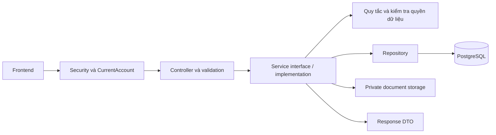

# 02 — Kiến trúc triển khai Function 1

Kiến trúc ngoài implementation vẫn là đề xuất. P01–P09 APPROVED theo [review P09-FIX-01](reviews/P09_FIX_01_REVIEW.md). P10 đã triển khai và READY_FOR_REVIEW; xem [API handoff](17_FUNCTION_1_HANDOFF.md), [acceptance](18_FUNCTION_1_ACCEPTANCE.md) và [report](reports/P10_REPORT.md). U-19/U-20/U-21/locks/schema giữ.

## 1. Stack và cấu trúc

Giữ stack nguồn: **Java 21, Spring Boot 4.0.8, Maven, PostgreSQL trên Supabase, Lombok**. Java 21 nằm trong khoảng tương thích của Spring Boot 4.0.8 theo [tài liệu hệ thống Spring Boot](https://docs.spring.io/spring-boot/4.0/system-requirements.html). Không tự nâng version chỉ vì có bản mới; để dependency management của Boot chọn Spring Framework/Security tương thích. Dùng import `jakarta.*` phù hợp Boot 4.

Một ứng dụng Spring Boot, tổ chức theo layer hiện có trong quy ước; thêm nhóm chức năng dưới layer khi cần:

```text
com.carrental
├── config                 SecurityConfig, CorsConfig, ClockConfig, properties
├── security               CurrentAccount, principal/converter, 401/403 handlers
├── controller             Auth, Customer, UserDocument, Driver, BankAccount, Voucher
├── service                Các interface nghiệp vụ
│   ├── impl               XxxServiceImpl
│   └── policy             KycPolicy, DriverEligibilityPolicy, quy tắc thuần
├── repository             5 repository tương ứng 5 entity F1
├── entity                 Customer, UserDocument, Driver, BankAccount, Voucher
│   └── base               BaseEntity (id/createdAt), AuditedEntity (+updatedAt)
├── dto
│   ├── request
│   └── response           ApiResponse, PageResponse và response từng use case
├── enums                  Status/type đúng CHECK SQL
├── exception              ErrorCode, AppException, GlobalExceptionHandler
├── storage                PrivateDocumentStorage interface + implementation
└── job                    Chỉ thêm job hết hạn giấy tờ nếu Q-02/Q-03 đã thống nhất
```

Không cần tạo sẵn mọi package/class rỗng. Không tạo module cho 14 bảng của thành viên khác trong nhiệm vụ F1.

## 2. Hướng đi của một request



Controller nhận DTO, principal và tham số trang. Service quyết định quyền trên bản ghi, giao dịch, chuyển trạng thái và tạo response. Repository thực hiện truy vấn có phạm vi quyền. Không mapping entity ở controller sau khi transaction đã đóng.

## 3. Service và trách nhiệm

| Interface | Trách nhiệm | Không chứa |
|---|---|---|
| `AuthService` | Register, authenticate và phát access token | CRUD xe, cấp role do client yêu cầu |
| `CustomerService` | Hồ sơ của tôi, danh sách admin, khóa/mở, dữ liệu xác minh tối thiểu cho nội bộ | Duyệt giấy tờ bằng cập nhật trực tiếp `kyc_status` |
| `UserDocumentService` | P05: tạo submission PENDING và truy xuất có quyền | P05 không duyệt, không cập nhật KYC và không gán hồ sơ cho account khác |
| `DriverService` | Tạo profile, đọc, đổi trạng thái và đánh giá điều kiện hiện tại | Gán xe, điều phối tài xế |
| `BankAccountService` | Thêm, danh sách, đổi mặc định, xóa theo điều kiện, xác minh chủ sở hữu | Tính tiền và thực hiện payout |
| `VoucherService` | Admin quản lý định nghĩa voucher, đọc điều kiện cho tích hợp | Tính giá đơn, tự giữ/nhả lượt khi tạo/hủy đơn |

Mỗi interface có một implementation `XxxServiceImpl`, dùng constructor injection. Helper thuần tính toán không cần một interface hình thức. `UserDocumentService` hợp lý vì có workflow duyệt độc lập; điều này khác service CRUD thừa cho ảnh con không có nghiệp vụ riêng.

## 4. Authentication, JWT và CORS

### Đăng ký và đăng nhập

1. Chuẩn hóa email bằng trim + lowercase nhất quán; chuẩn hóa phone theo Q-08, không tự cắt số 0 đầu.
2. Validate field và chiều dài; kiểm tra trùng để trả lỗi dễ hiểu, giữ UNIQUE DB làm bảo vệ khi hai request cùng chạy.
3. Server gán role/status mặc định; hash qua `PasswordEncoder`, lưu định dạng có tiền tố thuật toán khi dùng `DelegatingPasswordEncoder`.
4. Login dùng cơ chế xác thực của Spring; lỗi email/mật khẩu/khóa account trả thông báo chung, tránh tiết lộ thêm tình trạng tài khoản.
5. Phát JWT với `sub` là customer ID dạng chuỗi, `iat`, `exp`, `iss`, `aud`; role nếu có chỉ là bản chụp, không phải nguồn duy nhất cho quyền hiện tại.

`PasswordEncoder` cung cấp biến đổi một chiều cho mật khẩu; factory của Spring hỗ trợ `DelegatingPasswordEncoder`. Mức chi phí hash cần cấu hình và đo trên môi trường chạy. [Nguồn Spring Security](https://docs.spring.io/spring-security/reference/features/authentication/password-storage.html).

### Xác thực request

- Dùng hỗ trợ JWT Resource Server của Spring (`JwtDecoder` và converter phù hợp), không tự parse chuỗi JWT rồi tin payload.
- Bộ phát token dùng `JwtEncoder` và khóa cấu hình; không triển khai một authorization server riêng chỉ để đăng nhập nội bộ.
- Kiểm tra thuật toán được chấp nhận, chữ ký, issuer, audience, hạn token; `aud` cần validator rõ ràng, không mặc định cho rằng framework đã kiểm tra đúng audience của ứng dụng.
- Sau xác thực token, đọc account hiện tại từ DB để từ chối `LOCKED`/account không tồn tại và lấy role hiện tại. `CurrentAccount` là record/dữ liệu bất biến gồm ID và role, không đưa JPA entity chứa password vào controller.
- Endpoint phân quyền qua `@EnableMethodSecurity` và `@PreAuthorize`, tiếp tục kiểm tra sở hữu trong service/query. Không có annotation Spring chuẩn tên `#list` để tự giải quyết mọi trường hợp.
- Các lỗi trước controller dùng `AuthenticationEntryPoint`/`AccessDeniedHandler` trả cùng envelope lỗi; không kỳ vọng `@ControllerAdvice` bắt toàn bộ lỗi security filter.

Spring hỗ trợ xác minh bearer JWT qua resource server; method security phải được bật rõ ràng. [JWT](https://docs.spring.io/spring-security/reference/servlet/oauth2/resource-server/jwt.html), [method security](https://docs.spring.io/spring-security/reference/servlet/authorization/method-security.html).

### Token transport và CORS

- Baseline đề xuất: bearer token trong header `Authorization`; không dùng cookie xác thực tự gửi trong thiết kế ban đầu.
- CORS whitelist origin, method và header theo cấu hình môi trường. Không hardcode mọi frontend domain vào Java, không mở tất cả origin để sửa lỗi tạm thời.
- Preflight cần được xử lý trước authentication. Chỉ tắt CSRF cho API có mô hình bearer header đã xác định; nếu chuyển token/session sang cookie phải đánh giá và cấu hình CSRF lại.
- TTL token, origin thật, key provisioning thuộc Q-01. Không commit khóa riêng hoặc secret. Không gọi thao tác xóa token ở client là thu hồi token trên server.

Thứ tự xử lý CORS và cơ chế CSRF cần phù hợp mô hình xác thực. [CORS](https://docs.spring.io/spring-security/reference/servlet/integrations/cors.html), [CSRF](https://docs.spring.io/spring-security/reference/servlet/exploits/csrf.html).

### P03 đã triển khai trên baseline kỹ thuật

- `POST /api/auth/register` tạo CUSTOMER với role/status/KYC/email verification do server đặt; `POST /api/auth/login` dùng `DaoAuthenticationProvider`; `GET /api/customers/me` đọc ID từ `CurrentAccount`.
- Access JWT ký và xác minh bằng HS256 với `JWT_SECRET` từ cấu hình môi trường. Secret phải có ít nhất 32 byte UTF-8; TTL mặc định là `PT30M`, skew `PT30S`.
- Mỗi bearer request đọc customer hiện tại từ PostgreSQL; role/status trong token không cấp quyền. `LOCKED` hoặc account đã xóa bị từ chối ở request kế tiếp.
- Stateless, không dùng session/cookie auth; CORS bắt đầu với whitelist rỗng, credentials tắt, expose `X-Request-ID`. P03 chưa thêm API nghiệp vụ cho P04 trở đi.
- Encoder cấu hình dùng Delegating BCrypt (strength dev `10`), password tối thiểu dev `8` code points và tối đa `72` UTF-8 bytes do giới hạn BCrypt.
- Bootstrap ADMIN chỉ chạy khi `BOOTSTRAP_ADMIN_ENABLED=true`; giá trị mặc định là false. Đây là baseline triển khai, chưa xác nhận policy production hay policy vận hành admin cuối cùng.

## 5. Entity, audit và transaction

- `Long` ↔ BIGINT identity; `BigDecimal` scale 0 ↔ VND; `LocalDate` cho ngày sinh/ngày cấp/hạn; `LocalDateTime` ↔ TIMESTAMP theo giờ `Asia/Ho_Chi_Minh` như schema.
- Inject `Clock` với zone rõ ràng để kiểm tra thời gian, không dựa vào timezone hệ điều hành. DB giữ hàm `vn_now()`.
- Đề xuất lấy DB default/trigger làm nguồn audit vì SQL đã có sẵn. Map audit là giá trị DB sinh và đọc lại sau ghi theo khả năng Hibernate phù hợp; kiểm tra response nhận audit đúng. Không đồng thời dùng `@CreationTimestamp`/`@UpdateTimestamp` từ một clock khác cho cùng cột.
- P02 theo xác nhận mới nhất giữ schema leader: BaseEntity có ID/createdAt; AuditedEntity thêm updatedAt cho 4 bảng F1 có cột này. BankAccount chỉ dùng phần audit đã có. Đề xuất bổ sung bank_accounts.updated_at chờ phối hợp leader, không phải migration được giao ở P02. Không ép thành viên khác kế thừa base vào bảng thiếu audit.
- Quan hệ `ManyToOne` tải LAZY; không dùng Lombok `@Data` trên entity có liên kết hai chiều. Tránh `toString`/equals đệ quy và lộ password.
- Không tự cascade REMOVE từ account sang mọi dữ liệu có lịch sử. Dùng khóa account thay cho delete chung.
- Use case ghi dùng `@Transactional` ở service implementation public. Đọc dùng `readOnly=true` khi thích hợp; điều này không tự thêm kiểm tra quyền.
- Không gọi method `@Transactional` trong cùng object rồi mặc định cho rằng một transaction mới đã được mở. Transaction qua proxy có quy tắc self-invocation riêng. [Nguồn Spring](https://docs.spring.io/spring-framework/reference/data-access/transaction/declarative/annotations.html).

## 6. Duyệt giấy tờ và hồ sơ tài xế

### Trạng thái được nguồn xác nhận

| Thuộc tính | Giá trị theo SQL | Luồng đề xuất trong F1 |
|---|---|---|
| Customer status | `ACTIVE`, `LOCKED` | Admin khóa/mở qua command riêng |
| KYC summary | `NONE`, `PENDING`, `VERIFIED`, `REJECTED` | Tính lại từ giấy tờ theo Q-02; client không chọn |
| Document verify status | `PENDING`, `APPROVED`, `REJECTED` | Chỉ `PENDING → APPROVED/REJECTED`; terminal command luôn409, không retry thành công |
| Driver status | `PENDING`, `ACTIVE`, `SUSPENDED` | `PENDING → ACTIVE/SUSPENDED`, `ACTIVE → SUSPENDED`, `SUSPENDED → ACTIVE` sau kiểm tra lại |
| Voucher status | `ACTIVE`, `INACTIVE` | Admin bật/tắt; hiệu lực thực tế còn phụ thuộc khoảng ngày và quota |

Các mũi tên là luồng triển khai, không phải tập giá trị do CHECK tự áp đặt. P06 review chỉ đổi `PENDING`; KYC là kết quả tổng hợp, không dùng switch một bản ghi nếu nhiều hồ sơ cùng tồn tại. Helper `KycPolicy` dùng chung cho review-time snapshot và current summary.

P06 implementation có `PATCH /api/user-documents/{id}/review` qua `UserDocumentService.review`. ADMIN ACTIVE được đọc lại trong transaction; U-11 cấm tự review. Owner LOCKED vẫn được ADMIN khác xử lý nhưng review không unlock account. Approve kiểm tra đủ metadata/ngày và đọc lại bytes ảnh private theo U-13; reject chỉ cần reason hợp lệ, không cần storage hoặc metadata hoàn chỉnh. Success log chỉ được phát sau commit.

### Một lần duyệt giấy tờ

1. Validate command body thuần dữ liệu, lấy actor ID từ principal.
2. Trong transaction lấy shared PostgreSQL advisory lock (`CustomerStatusLock`), lock/recheck actor ACTIVE/ADMIN, scalar-discover owner, rồi lock owner và document theo thứ tự global→actor→owner→document.
3. So owner sau khóa, cấm self-review, và chỉ cho bản `PENDING` đi tiếp; terminal trả409.
4. Approve kiểm tra metadata/ngày/ảnh theo U-13 rồi precheck số giấy tờ đã duyệt; unique index leader vẫn là authority. Reject ghi reason đã trim mà không đọc file.
5. Ghi trạng thái, `verified_by`, `verified_at`, `reject_reason` theo command; không đổi owner/type/number/ảnh, profile, role hoặc account status.
6. Flush document, tính KYC current theo cùng Clock/projection, cập nhật snapshot nếu đổi và flush customer trong cùng transaction. Không cập nhật driver từ KYC.
7. Response chỉ trả detail allowlist, KYC lúc command và ngày đánh giá. Log metadata đăng ký để chạy after-commit; rollback không phát success event.

### KYC đã triển khai trong P06

User xác nhận U-12: chỉ CCCD (`CITIZEN_ID`) hoặc PASSPORT là proof identity; GPLX tách riêng cho eligibility driver/P07 và không ảnh hưởng identity KYC. U-13 quy định metadata và mặt ảnh khi approve. Policy đánh giá theo `LocalDate.now(applicationClock)`: valid APPROVED identity (hạn NULL hoặc `>= today`) → VERIFIED; nếu không, PENDING trước REJECTED rồi NONE. Hạn hôm nay còn hiệu lực; approved cũ hết hạn không bị tự chuyển REJECTED.

`customers.kyc_status` là snapshot tại command review, cập nhật cùng transaction chỉ khi thay đổi. `GET /api/customers/me/kyc` (owner ACTIVE) và `GET /api/customers/{id}/kyc` (ADMIN ACTIVE, có thể xem LOCKED target) trả current KYC qua một aggregate SQL statement trong read-only transaction, không cập nhật audit/snapshot. Client/F2/F3/P07 không dùng snapshot đơn lẻ cho eligibility thời gian thực; query current summary hoặc policy chuyên biệt theo thời điểm.

## 7. Upload giấy tờ

- Metadata đi cùng multipart form; service chỉ nhận JPEG/PNG theo giới hạn byte/pixel/chiều cấu hình được. Kiểm tra signature, decoder, MIME và extension trước khi decode, sau đó re-encode để loại metadata/bytes thừa.
- Đường dẫn/object key do server sinh và gắn chủ sở hữu. Không lấy URL bất kỳ từ client rồi tải server-side.
- Bảng đang đặt tên `front_image_url`/`back_image_url`; đề xuất lưu locator ổn định tới object private, không lưu signed URL có thời hạn làm dữ liệu gốc.
- User đã chọn local private ngoài public/JAR cho P05 (U-10). PrivateDocumentStorage interface/local adapter lưu opaque locator vào hai cột URL đang có; API file kiểm tra quyền owner/admin rồi trả binary ảnh qua JWT. Không expose locator/path/public/signed URL. Storage tắt mặc định; khi bật root phải có sẵn, absolute, writable và ở ngoài ứng dụng/repository/public resources.
- R3 CLOSED sau P05-FIX-02: nested CodeSource được unwrap qua Boot parser thành physical native outer JAR, protected roots độc lập CWD. Giữ actual Boot JarLauncher/encoding/forbidden/external regression khi đổi runtime; plain JAR test riêng không thay Boot case.
- P06-FIX-01 được reviewer APPROVED: giữ review command global advisory→actor→owner→document; diagnostics failure chỉ ghi metadata an toàn; actual upload/review holder/waiter PID và KYC PENDING precedence có regression HTTP/PostgreSQL. Xem [P06 implementation](13_DOCUMENT_REVIEW_KYC.md), [P06 report](reports/P06_REPORT.md) và [fix report](reports/P06_FIX_01_REPORT.md). Không dùng snapshot cũ làm eligibility F2/F3.
- Upload file ngoài transaction DB, rồi mở transaction ngắn để khóa/recheck owner ACTIVE và ghi metadata. Cleanup chỉ xóa receipt của submission đó khi rollback chắc chắn. Nếu commit outcome không chắc, giữ file để tránh xóa file DB có thể đang tham chiếu; cần reconciliation vận hành. Không tuyên bố filesystem và DB atomic khi process/OS crash.
- Retry không xóa nhầm object đã được bản ghi khác dùng; cleanup thất bại phải log ID kỹ thuật và có đường khắc phục.
- Không gọi upload provider trong lúc giữ khóa account lâu. `try-with-resources` dùng khi thực sự quản lý stream.

## 8. Đồng thời và khóa

F1 không có cột `version` ở 5 bảng. Không thêm `@Version` vào entity khi chưa có migration.

- Với thay đổi giấy tờ/driver/ngân hàng cùng account: khóa row customer trước, rồi các row con theo ID ổn định. Các writer liên quan phải dùng cùng thứ tự để tránh race/deadlock.
- Đổi ngân hàng mặc định: khóa customer kể cả khi chưa có bank account; bỏ default cũ và flush trước khi đặt default mới để không vi phạm partial unique index giữa chừng. Cả hai bước cùng transaction.
- Duyệt giấy tờ trùng giữa hai customer: UNIQUE DB là chốt bảo vệ cuối cùng; pre-check không đủ.
- Sửa voucher: khóa row voucher; adapter đặt/nhả lượt của F3 cần dùng giao thức khóa hoặc atomic update tương thích. Không gán toàn bộ entity từ DTO làm mất `used_count`.
- Không giữ transaction/row lock trong lúc gọi mạng. Nếu cần retry deadlock/optimistic conflict, retry cả use case có giới hạn và bảo đảm không lặp side effect.

PostgreSQL có row lock và giữ lock đến khi transaction kết thúc. Dùng khóa chỉ ở luồng có tranh chấp cụ thể, không khóa mọi truy vấn đọc. [Nguồn PostgreSQL](https://www.postgresql.org/docs/15/explicit-locking.html).

## 9. Hợp đồng với thành viên khác

| Bên dùng | F1 cung cấp | Bên dùng phải tự làm |
|---|---|---|
| F2 | `CurrentAccount`; thông tin account ACTIVE; kết quả driver đủ điều kiện tại thời điểm kiểm tra | Quyền chủ xe, đăng/duyệt xe, gán driver, slot |
| F3 | Account ID; kết quả KYC/GPLX tối thiểu; snapshot định nghĩa voucher | Điều kiện đặt đơn, giá/rounding, giữ/nhả lượt, trạng thái đơn |
| F4 | Kết quả bank account thuộc customer, dữ liệu chuyển khoản chỉ khi quyền cho phép | Xác định recipient, payment, payout và audit tài chính |

Hợp đồng nội bộ giữa các function cần thống nhất khi tích hợp, không tự thêm implementation tương lai. Current driver eligibility phục vụ chính F1 nên giữ; full-payee lookup dành cho F4 đã bỏ ở audit2026-10-15 theo yêu cầu user thu gọn phạm vi.

### Điểm giao voucher cần nhóm thống nhất

- F1 quản lý định nghĩa; F3 quản lý tác động của đơn tới lượt dùng. Một nơi duy nhất chịu trách nhiệm thao tác reserve/release và chống chạy lại.
- `used_count` không đủ chứng minh voucher chưa từng được dùng; đơn hủy/hoàn có thể đã thay đổi số đếm.
- Trước khi cho sửa code/giá trị giảm/thời gian: cần kiểm tra voucher đã được đơn tham chiếu hay chưa qua hợp đồng với F3. Khi chưa có kiểm tra này, phương án an toàn là giữ bất biến các trường đó sau tạo, tạo voucher mới khi đổi chính sách.
- Hạ `usage_limit` phải không thấp hơn số đã sử dụng/đã giữ theo chính sách nhóm. Vô hiệu hóa không tự làm biến mất discount đã snapshot trong đơn.
- Các quy tắc reserve/release, `per_user_limit`, thời điểm tiêu hao và refund cần chủ Function 3 quyết định; không trì hoãn register/login vì phần này.

## 10. P04 profile và admin status đã triển khai

- Profile PATCH khóa đúng customer row trong transaction, đọc lại status ACTIVE, phân biệt field không gửi với null, chỉ sửa ba field allowlist và flush khi normalized value thay đổi. PostgreSQL là nguồn updated_at.
- Admin list/detail/status ở cùng CustomerController/CustomerService. List/page/count dùng JPA Specification trên PostgreSQL, map request sort qua allowlist, escape %, _, và backslash trong LIKE search; CUSTOMER bị từ chối trước query.
- Mọi status command lấy transaction advisory lock chung trước row lock actor/target, kiểm tra lại role/status của actor từ DB, rồi áp dụng transition. Profile không lấy advisory lock; cả hai luồng chỉ row-lock với thứ tự không tạo vòng chờ.
- Policy được xác nhận: cấm ADMIN tự khóa và cấm làm số ADMIN ACTIVE về 0. Status change log chạy after-commit và chỉ chứa metadata an toàn; reason không có cột lưu, Q-09 vẫn mở.
- CORS cho phép PATCH theo cấu hình hiện có. Không thêm bảng/cột/index/trigger hay thay leader schema.

## 11. P06 review/KYC implementation

Approval/rejection/API fields, error codes, request locking, unique handling, current KYC scope, frontend contract and operational limits are detailed in [13 — Document review and KYC](13_DOCUMENT_REVIEW_KYC.md). PostgreSQL/HTTP/concurrency evidence is in [P06 report](reports/P06_REPORT.md). P06 adds no schema changes or document history; P07 driver activation is a separate implementation.

## 12. P07 hồ sơ tài xế và current eligibility

P07 APPROVED/R1 CLOSED theo review FIX-01; giữ một-query current evidence và Java strip parity.

P07 triển khai `DriverController`/service, DTO allowlist, mapper, `DriverEligibilityPolicy` và projection aggregate. `drivers` chỉ giữ profile/status theo schema leader; DRIVER không phải role. API create mặc định PENDING, GET profile/eligibility có scope owner/admin, admin list lọc/phân trang tại DB và status command strict. Xem [14 — Driver profile and eligibility](14_DRIVER_PROFILE_ELIGIBILITY.md) cho hợp đồng đầy đủ.

Current eligibility và activation cùng dùng một câu SQL aggregate trên customer, profile, identity docs và GPLX; KYC identity được tính lại qua `KycPolicy` theo Clock, không dùng snapshot `customers.kyc_status` làm nguồn duy nhất. GPLX đúng owner phải `DRIVER_LICENSE`, `APPROVED`, có hạn `>= today` và `license_class` không blank. Stored ACTIVE có thể thành current-ineligible theo ngày/account mà không auto-suspend.

R1 review probe cho thấy `btrim` mặc định không xử lý TAB/EM SPACE ở GPLX APPROVED legacy/import. P07-FIX-01 sửa predicate trong projection theo semantics Java 21 `strip()` bằng Java whitespace set tường minh; matrix/HTTP regressions PASS. P06 HTTP approval rules, schema và dữ liệu legacy không đổi.

Write create/status dùng shared advisory lock trước row locks cùng P04/P06. Status recheck actor/owner trong transaction theo thứ tự global→actor→owner→driver; status event/failure diagnostics chỉ ghi safe fields và success event chạy after commit. U-14/U-15 đã được giữ nguyên; không thêm schema/role, reason column hay lịch sử mới. Bằng chứng HTTP/PostgreSQL/concurrency/full verify xem [P07 report](reports/P07_REPORT.md).

## 13. P08 ngân hàng — APPROVED

[P08](prompts/P08_BANK_ACCOUNTS.md) đã triển khai theo 9 bước; kiểm tra và giới hạn thực tế ở [báo cáo](reports/P08_REPORT.md) và [hợp đồng ngân hàng](15_BANK_ACCOUNTS.md). U-16 chỉ tạo default khi makeDefault=true; U-17 xóa default không bị tham chiếu để zero default; U-18 thông tin nhận tiền bất biến. HTTP owner-only cho CUSTOMER/ADMIN ACTIVE, response che số và chỉ có createdAt theo schema.

Writes dùng shared advisory → own customer row → bank rows, đọc lại actor/status và clear/flush trước set hoặc insert default trong cùng transaction. Partial unique là authority tối đa một default, composite FK F4 ngăn referenced delete. Errors map theo SQLState/constraint đúng, safe logs và after-commit events; không thêm schema hoặc query payouts trong baseline F1.

Internal full-payee lookup/DTO đã bỏ theo audit scope mới. F1 giữ HTTP owner/mask/default/delete và composite FK protection. Test-only reference fixture kiểm chứng lỗi FK khi xóa bank, không triển khai module payouts.

## 14. P09 voucher admin — APPROVED/R1 CLOSED

P09 đã triển khai đủ 9 bước; P09-FIX-01 sửa R1 bằng `JsonMapperBuilderCustomizer` production dùng `USE_BIG_DECIMAL_FOR_FLOATS`. JSON floating token thành exact BigDecimal-backed JsonNode trước custom request setters/service validation; actual MVC HTTP regression xác nhận HTTP400/no row cho fractions/underflow. Nested type tests giữ số `usageLimit`/`perUserLimit` `1.0`/`1e0` invalid. [Báo cáo](reports/P09_FIX_01_REPORT.md); P09 review gốc giữ lịch sử.

Writes global advisory → actor row → voucher row, recheck ADMIN và kiểm tra quota với latest usedCount dưới lock. F3 counter writer dùng cùng voucher resource/atomic conditional update, không đọc entity cũ rồi ghi đè; admin không sửa counter. Tests chờ JDBC counter writer tổng hợp phải thấy latest count và giữ commit của writer, không gọi là full F3 reservation/pricing đã test.

F3 chủ trì giá, per-user usage, meaning used_count/reserve-release và order snapshot; P09 chỉ quản trị definition, không thêm order/usage module, entity/schema/index/version hoặc expire job. Giữ trace/error classification/safe logs/after-commit và P01–P08 regressions.

## 15. P10 kiểm tra và bàn giao — READY_FOR_REVIEW

[P10](prompts/P10_FUNCTION_1_HANDOFF.md) gồm 9 bước đã triển khai. Static OpenAPI 3.1 JSON có parity với actual MVC mappings và DTO examples; không Swagger runtime/dependency hoặc API mới. Workflow HTTP/PostgreSQL dùng synthetic accounts/documents/private root/Clock; standard executable JAR smoke dùng external config từ CWD Unicode/space khác, không test-helper Start-Class. Full 147-test regression và packaging probe PASS; chi tiết trong [report](reports/P10_REPORT.md).

Handoff FE/F2/F3/F4 giữ policy/current snapshot/locks/privacy và ranh giới mỗi function; test-only counter/FK fixtures không full integration. P10 chờ review cuối; production/shared DB/RLS/ACL/throughput/crash limitations giữ.
