# Sơ đồ từng luồng Function 1

Ngày2026-10-15. Đây là luồng implementation hiện tại để user review, không tự thêm feature. Nguồn chính là service/controller/SQL leader; policy U-09–U-21 do user đã chọn được tách khỏi ràng buộc SQL. [Checklist scope](20_FUNCTION_1_SCOPE_SCHEMA_AUDIT.md), [59 cột entity](22_ENTITY_SCHEMA_FIELD_MAP.md), [chạy Supabase](SUPABASE_SETUP.md).

## 0. Kiến trúc chạy thật

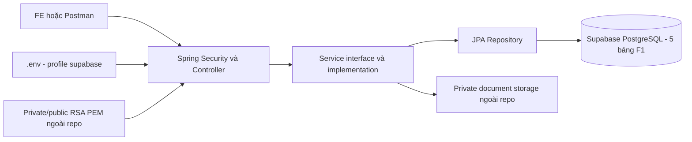

Supabase ở đây là database. Không dùng Supabase Auth, không cần anon/service-role API key cho JDBC, chưa chuyển ảnh sang Supabase Storage. Khi chạy test, DB được thay bằng PostgreSQL Testcontainer; Docker không nằm trên đường chạy ứng dụng với Supabase.

### Quan hệ dữ liệu đúng phạm vi

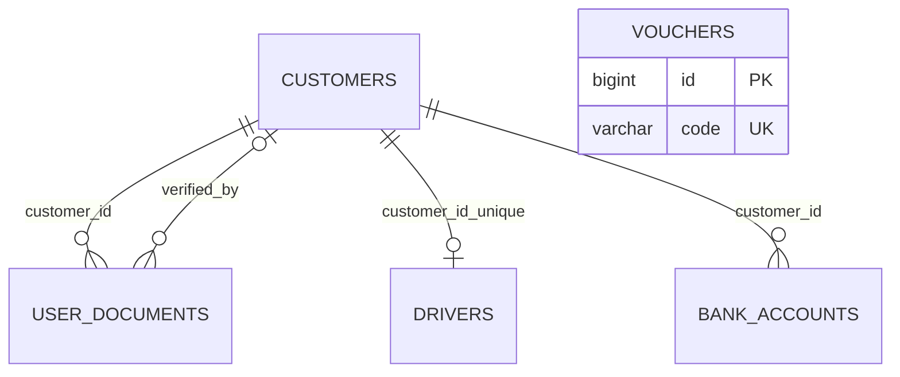

`vouchers` không có customer_id/created_by trong schema; không vẽ thêm FK đến ADMIN vì ADMIN là người thao tác API. Quan hệ từ orders/payouts đến voucher/bank thuộc schema nhóm nhưng không tạo entity/service của các function đó trong F1.

## 1. Đăng ký — POST /api/auth/register

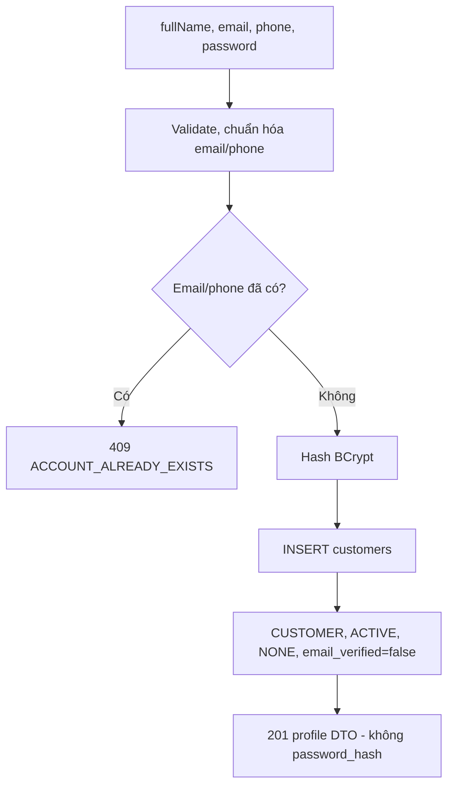

Chỉ ghi `customers`; ID/created_at/updated_at do DB sinh. Unique DB là chốt cuối cho hai registration đồng thời. Client không được chọn ADMIN/KYC/verified/audit. Không có OTP/email verification trong luồng này.

## 2. Đăng nhập và kiểm tra JWT

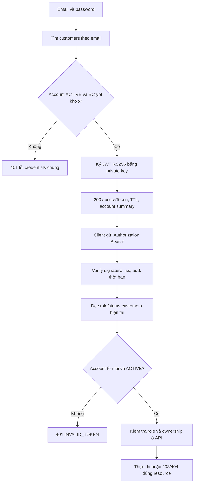

Login không tạo bảng token/refresh session, không sửa `email_verified`. JWT không phải Supabase Auth token. Account bị khóa bị chặn ở request kế tiếp dù access token chưa hết hạn.

## 3. Hồ sơ cá nhân và admin quản lý account

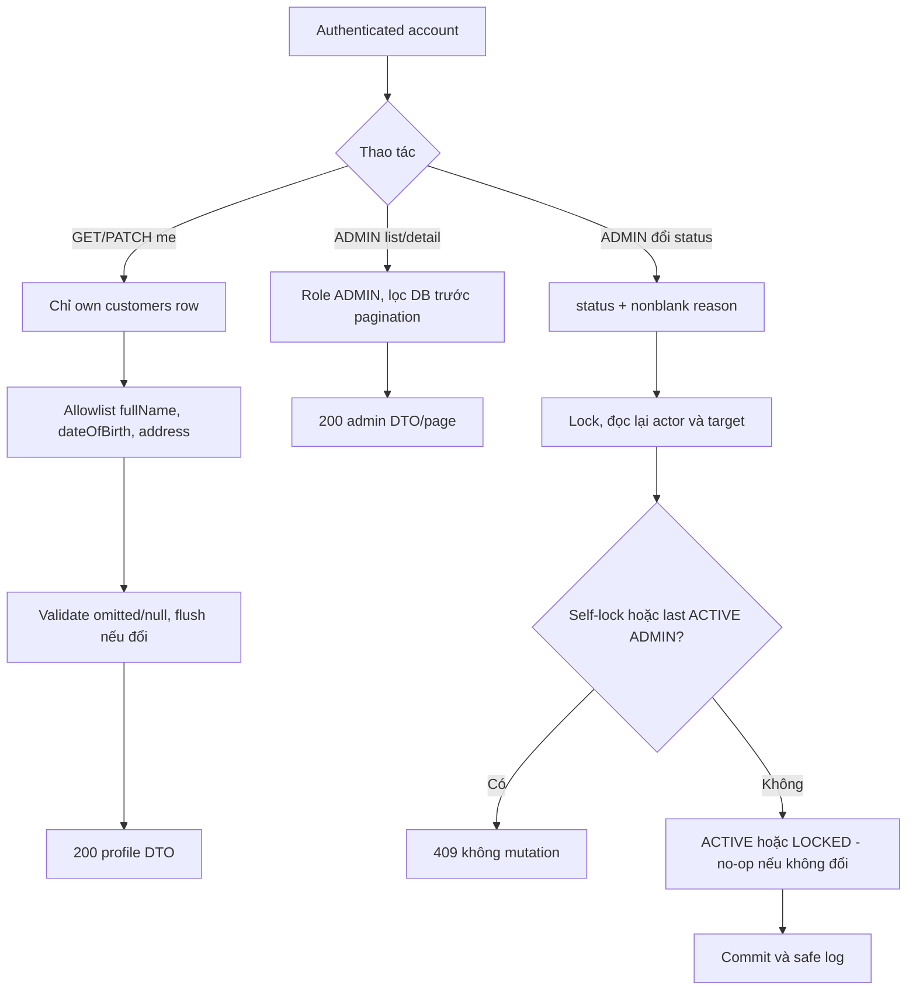

Chỉ ghi fields sẵn trong `customers`. Lý do status được validate nhưng schema không có cột lưu history/reason; không tự tạo thêm bảng. `avatar_url` và `email_verified` vẫn map đúng SQL nhưng chưa có luồng upload avatar/xác minh email.

## 4. Gửi giấy tờ — POST /api/user-documents

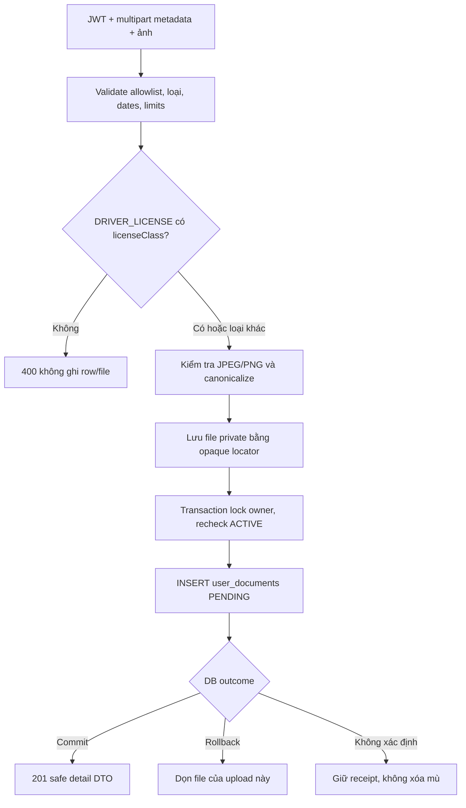

Ghi `user_documents`, không tự duyệt hoặc đổi snapshot KYC khi upload. frontImage bắt buộc, backImage optional ở submission. Metadata bắt buộc khi APPROVED là bước sau. `front_image_url/back_image_url` lưu locator private đúng cộtVARCHAR500, không tạo cột mới và không expose local path/public URL.

## 5. Xem/list/tải ảnh giấy tờ

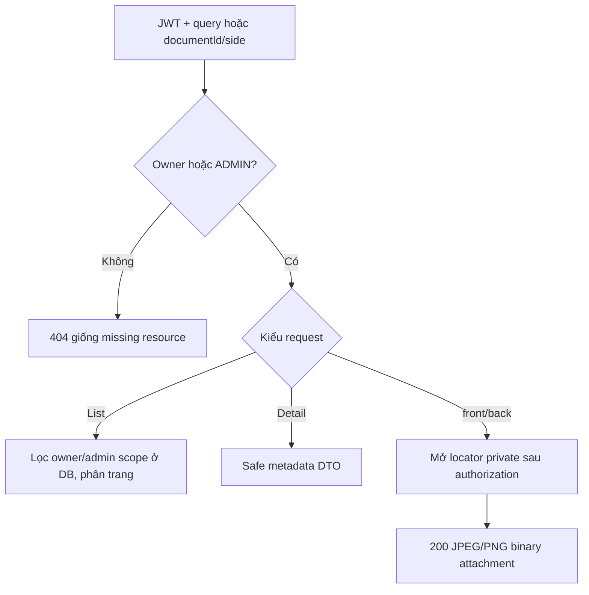

Download có no-store/nosniff/request ID; response lỗi vẫn JSON envelope. Không đưa file vào static resources và không gửi JWT trong URL.

## 6. ADMIN duyệt/từ chối và KYC

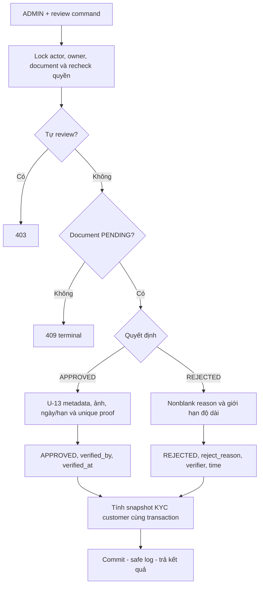

U-13 đã chốt: họ tên/DOB/ngày/nơi cấp; CCCD/GPLX hai mặt, passport một mặt; GPLX class và expiry; identity expiry nullable. SQL partial unique `(doc_type,doc_number)` khiAPPROVED là chốt cuối cho duplicate proof.

### Current KYC khi đọc

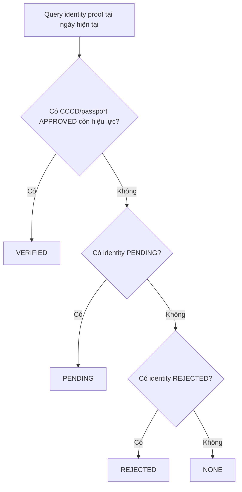

GPLX không tự làm identity KYC VERIFIED (U-12). `customers.kyc_status` là snapshot được review ghi; GET current KYC tính theoClock, không tạo cột `currentKycStatus`, không dùng enumEXPIRED. Hạn ngày có tính inclusive; expired identity APPROVED mà không có proof khác có thể cho currentNONE trong khi snapshot cũVERIFIED.

## 7. Hồ sơ tài xế

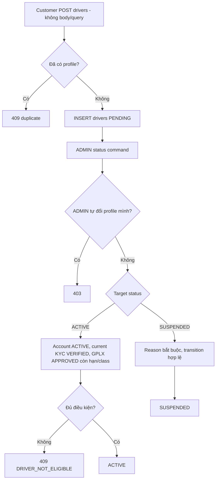

Transition: PENDING→ACTIVE; ACTIVE→SUSPENDED; SUSPENDED→ACTIVE. PENDING→SUSPENDED không hợp lệ. ACTIVE no-op vẫn kiểm tra eligibility; SUSPENDED no-op giữ audit. U-14/U-15 đã chốt, không thêm roleDRIVER hoặc field GPLX vào `drivers`.

GET eligibility trả `eligibleNow=true` khi storedACTIVE + accountACTIVE + currentidentityVERIFIED + validlicense. GPLX hết hạn khiến currentfalse, không auto-write SUSPENDED hoặc thêm scheduler. Không gán xe/slot/tài xế trong F1.

## 8. Tài khoản ngân hàng

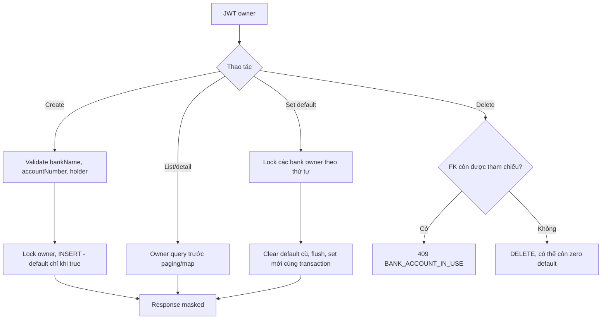

ADMIN không bypass ownership. Số account là String giữzero đầu. Không API sửa bankName/accountNumber/holder saucreate (U-18); thêm row mới. Bank chỉcreated_at, khôngupdated_at. Giữ FK protection của database gốc nhưng **không helper đầy đủ payee/payout F4** sau lượt tinh gọn.

## 9. ADMIN voucher definitions

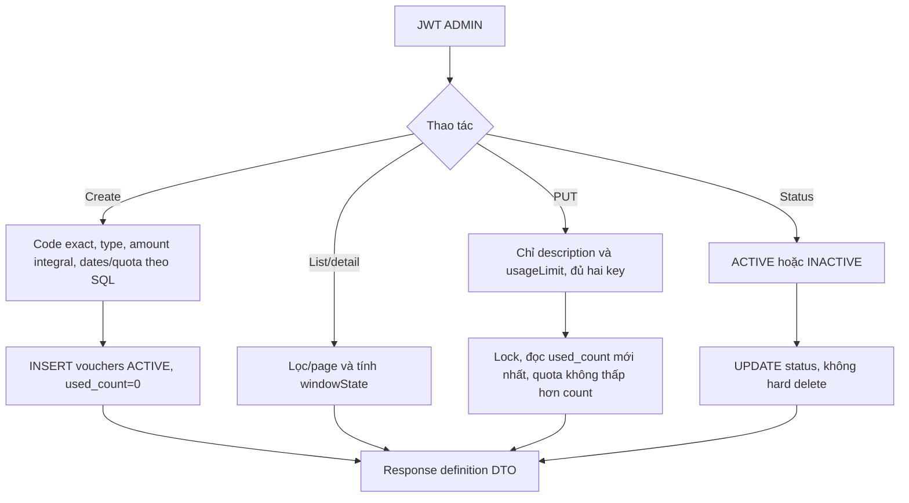

Tiền NUMERIC(14,0)/BigDecimal, PERCENT≤100. Code strip hai đầu, giữcase (U-21). Amount1.0/1e0 integral hợp lệ, quota cần integer token. Window UPCOMING/CURRENT/ENDED là computed DTO, không thêm cột. F1 không redeem/tínhgiá đơn, không ghi used_count theo request, không tạo rental_orders.

## 10. Điểm user cần review

- Các U-policy trên vẫn là quyết định trước đó của user, không phải cột SQL bắt buộc. Nếu đổi policy, cập nhật decision/test theo thay đổi cụ thể; không tự đổi entity/schema.
- Entity bắt buộc map cả59 cột dù chưa có feature sửa avatar/emailVerified; không xóa cột chỉ vì endpoint không nhận field đó.
- `.env`/Supabase JDBC chỉ thay nơi lấy DB config; không thay schema và không thêm Supabase Auth.
- Chưa kết nối project Supabase thật. Bản SQL gốc khớp entity không chứng minh dữ liệu/schema/RLS đang có trên cloud đã đúng; user điền cấu hình rồi kiểm tra startup và API thực.
